# AutoFirme Web

Firma electrónica con certificados X.509 **directamente en el navegador**. Sin servidor de firma,
sin backend para los flujos principales y sin que la clave privada salga del equipo: WebCrypto hace
el trabajo y los documentos se quedan en el cliente.

Reescritura limpia en TypeScript inspirada en AutoFirma 1.9, no una traducción de su código Java.
La app es una SPA instalable como PWA, con una extensión de Chrome que intercepta las llamadas
`AutoScript` de las sedes electrónicas y un servidor MCP opcional para agentes.

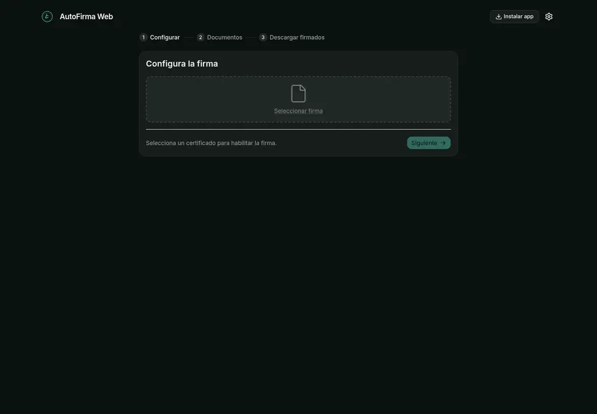

## Índice

- [Qué incluye](#qué-incluye)
- [Firmar documentos](#firmar-documentos)
- [Certificados e identidades](#certificados-e-identidades)
- [Formatos y algoritmos](#formatos-y-algoritmos)
- [Firma visible en PDF](#firma-visible-en-pdf)
- [Lote y descargas](#lote-y-descargas)
- [Sellos de tiempo](#sellos-de-tiempo)
- [Idiomas, temas y accesibilidad](#idiomas-temas-y-accesibilidad)
- [PWA y funcionamiento sin conexión](#pwa-y-funcionamiento-sin-conexión)
- [Extensión de Chrome](#extensión-de-chrome)
- [Servidor MCP](#servidor-mcp)
- [Privacidad y seguridad](#privacidad-y-seguridad)
- [Empezar en local](#empezar-en-local)
- [Autoalojamiento](#autoalojamiento)
- [Desarrollo y pruebas](#desarrollo-y-pruebas)
- [Estructura del repositorio](#estructura-del-repositorio)
- [Documentación](#documentación)
- [Alcance actual y limitaciones](#alcance-actual-y-limitaciones)

## Qué incluye

- **Firma guiada en tres pasos**: configuración, documentos y descarga de firmados.
- **Certificados PKCS#12** (`.p12` / `.pfx`) con PIN, claves no extraíbles e identidades guardadas
  cifradas en IndexedDB.
- **CAdES-BES**, **CAdES-T**, **XAdES-EPES** y **PAdES B-B/B-T**, con formato global o distinto por
  archivo dentro del mismo lote.
- **Firma visible en PDF**: imagen PNG/JPEG, nombre y fecha, por página y esquina.
- **Sellos de tiempo RFC 3161** opcionales mediante una TSA configurable.
- **PWA instalable**, responsive y con la interfaz disponible sin conexión.
- **Extensión de Chrome MV3** para webs que llaman a `AutoScript`, con selector de sitio y
  confirmación explícita de cada firma.
- **Servidor MCP** con transporte stdio y HTTP para que un agente liste certificados, firme y
  verifique CAdES.
- **ES/EN**, modo claro/oscuro/sistema y navegación por teclado.

## Firmar documentos

El flujo principal se divide en tres pasos y mantiene el estado del lote entre ellos.

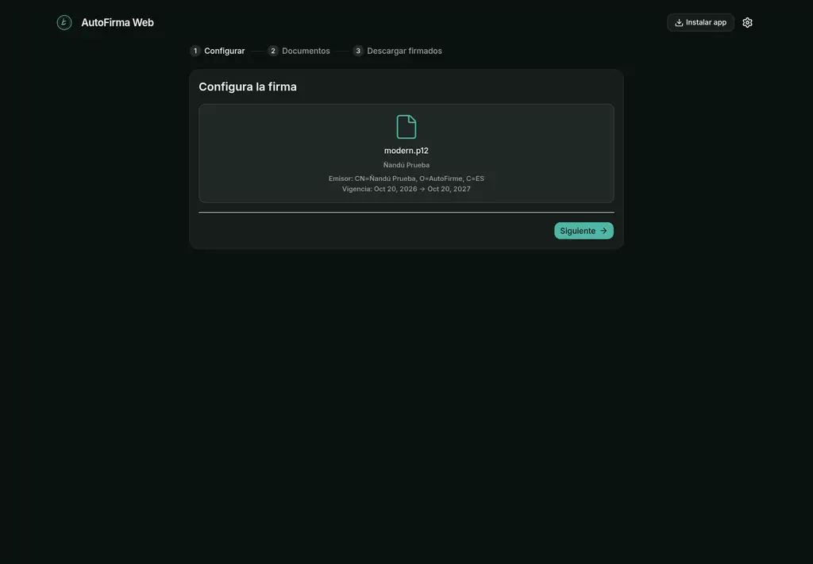

1. **Configurar**: elige o importa un certificado y, si procede, introduce el PIN.
2. **Documentos**: arrastra los archivos, revisa el formato de cada uno y activa la firma visible
   cuando sea un PDF.
3. **Descargar firmados**: la cola muestra el estado por documento; descarga los resultados uno a
   uno o todos en un ZIP con su `manifest.json`.

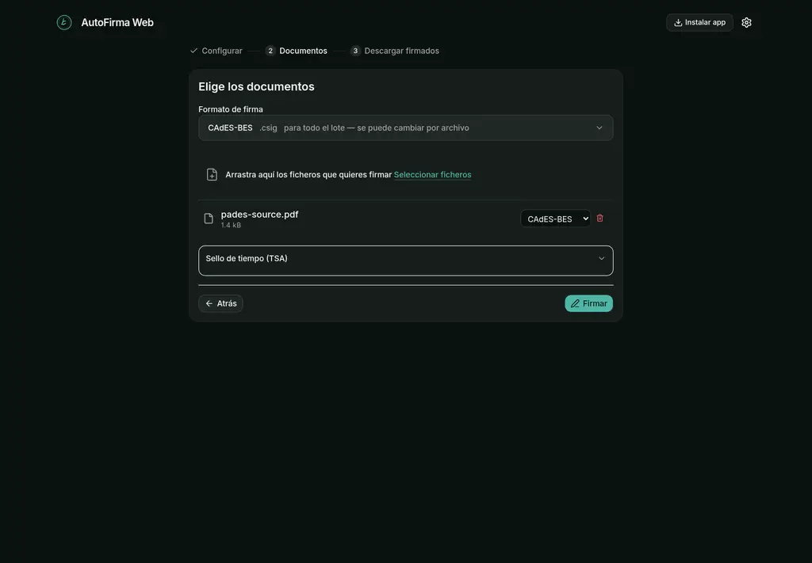

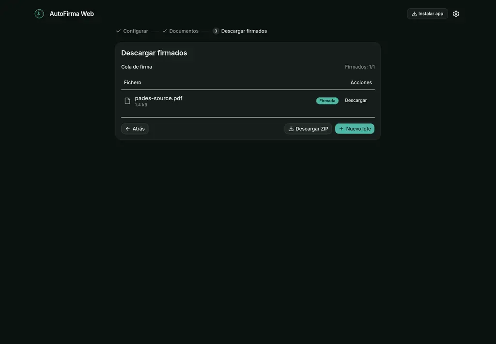

Cada documento conserva su propio estado (`pendiente`, `firmando`, `firmado` o `error`), de modo que
un fallo en un archivo no invalida el resto del lote.

## Certificados e identidades

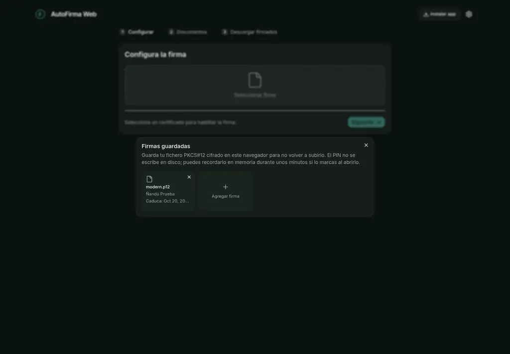

- Importación de contenedores **PKCS#12** con PIN. Se admiten PBES2 (PBKDF2 + AES-CBC) y los
  PBES1 antiguos (DES, RC2, RC4) implementados sin dependencias externas.
- La clave privada se importa como `CryptoKey` **no extraíble** con uso `['sign']`; no existe una
  operación para volcarla a disco.
- Las identidades guardadas se cifran con PBKDF2 → AES-GCM bajo el PIN del contenedor. El PIN
  **nunca se persiste**.
- El PIN puede recordarse solo en memoria durante N minutos; cerrar el navegador lo borra.

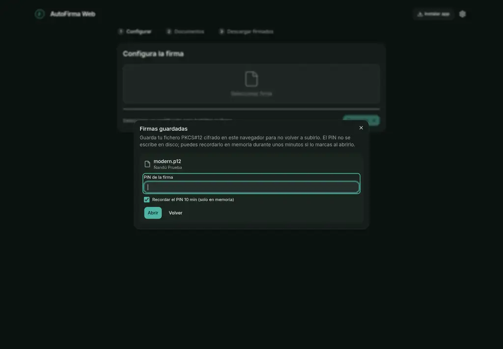

No hay acceso al almacén de certificados del sistema (Windows-MY, Llavero de macOS, NSS) ni a DNIe
o tarjetas inteligentes: el navegador no expone esas APIs. Es una limitación de plataforma, no una
decisión de diseño.

## Formatos y algoritmos

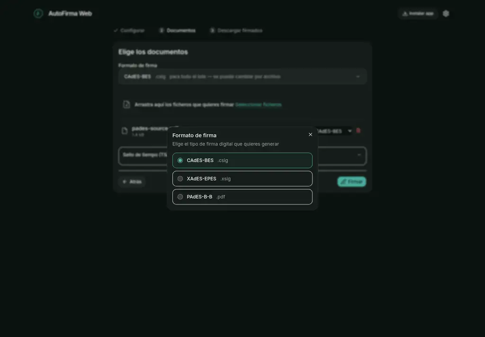

| Formato | Estado | Detalle |
|---|---|---|
| **CAdES-BES** (`.csig`) | Disponible en la interfaz | Firma *detached*; atributos `contentType`, `messageDigest`, `signingTime` y `signingCertificateV2`. |
| **CAdES-T** | Disponible | Sello RFC 3161 como atributo no firmado `id-aa-timeStampToken`. |
| **XAdES-EPES** (`.xsig`) | Disponible en la interfaz | XML envolvente, política EPES, C14N 1.0 y C14N exclusivo; SHA-256/384/512. |
| **XAdES-T** | No | Falta `SignatureTimeStamp`. |
| **PAdES B-B** (PDF) | Disponible en la interfaz | Actualización incremental real; `adbe.pkcs7.detached` / `ETSI.CAdES.detached`. |
| **PAdES B-T** | Disponible | Requiere una TSA configurada. |
| **OOXML** (`.docx`, `.xlsx`, `.pptx`) | Motor disponible, sin selector en la interfaz | Firma `XAdES v1.3.2` en `origin.sigs`; el resto del ZIP queda idéntico bit a bit. |
| ODF, FacturaE, ASiC-S, cofirma, contrafirma, *detached/enveloping* genéricos | No | Ver [`docs/PARITY.md`](docs/PARITY.md). |

Claves admitidas: **RSA (RSASSA-PKCS1-v1_5)** y **ECDSA P-256/P-384/P-521**. No se firma con SHA-1
ni con DSA.

## Firma visible en PDF

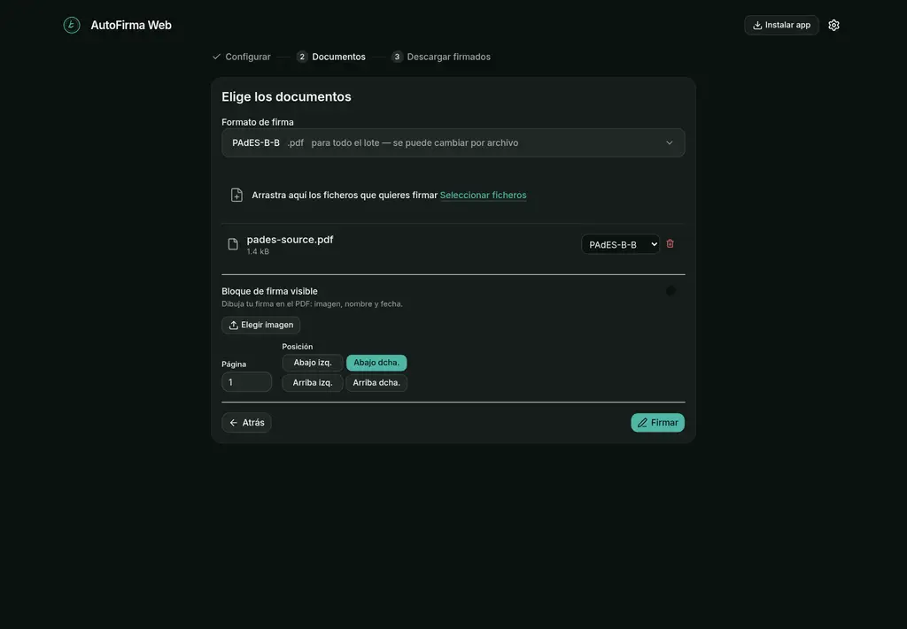

La firma visible se dibuja dentro de la actualización incremental del PDF, de forma que queda
cubierta por el `/ByteRange` de la propia firma. Permite:

- imagen PNG o JPEG, incluida transparencia mediante `/SMask`;
- nombre y fecha del firmante;
- selección de página y de esquina (abajo izquierda/derecha, arriba izquierda/derecha).

Está desactivada por defecto y solo aparece para documentos PDF.

## Lote y descargas

- Cola multiarchivo con estado y formato independiente por documento.
- Descarga individual de cada firma o **ZIP** de todo el lote.
- El ZIP incluye un `manifest.json` con los archivos y sus huellas.
- Las pruebas comprueban el ZIP con `unzip -t` y verifican las firmas con herramientas externas.

## Sellos de tiempo

CAdES-T y PAdES B-T aceptan una TSA RFC 3161 configurable. Solo se envía el **resumen SHA-256** del
contenido, nunca el documento ni la clave. La app no valida criptográficamente los sellos recibidos:
eso queda fuera de su alcance actual.

## Idiomas, temas y accesibilidad

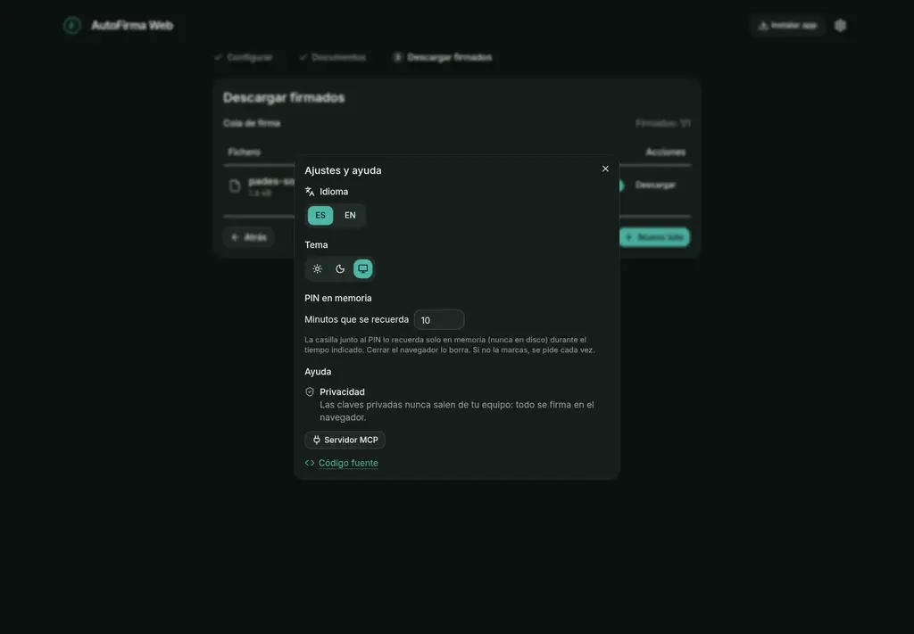

- Copia completa en **español e inglés**; español por defecto.
- Tema **claro, oscuro o sistema**, aplicado antes del primer pintado para evitar destellos.
- Responsive de 320 a 1280 px, navegación por teclado y roles ARIA en pestañas y diálogos.
- Mensajes de error y estados anunciados con `role="alert"` / `role="status"`.

## PWA y funcionamiento sin conexión

`pnpm build` genera `manifest.webmanifest` y un *service worker*. La cabecera muestra **Instalar app**
cuando el navegador ofrece la instalación y **Actualizar versión** cuando hay una versión nueva.

La *shell* de la aplicación se precachea, así que **firmar sigue funcionando sin red**. No se cachea
ningún documento generado: el *service worker* solo sirve `GET` del mismo origen y nunca guarda
resultados en caché.

## Extensión de Chrome

La extensión MV3 carga la misma aplicación y añade el puente que necesita una sede electrónica:
intercepta las llamadas `AutoScript` en sitios HTTP/HTTPS, muestra qué sitio y qué operación pide
permiso y exige una confirmación humana antes de firmar.

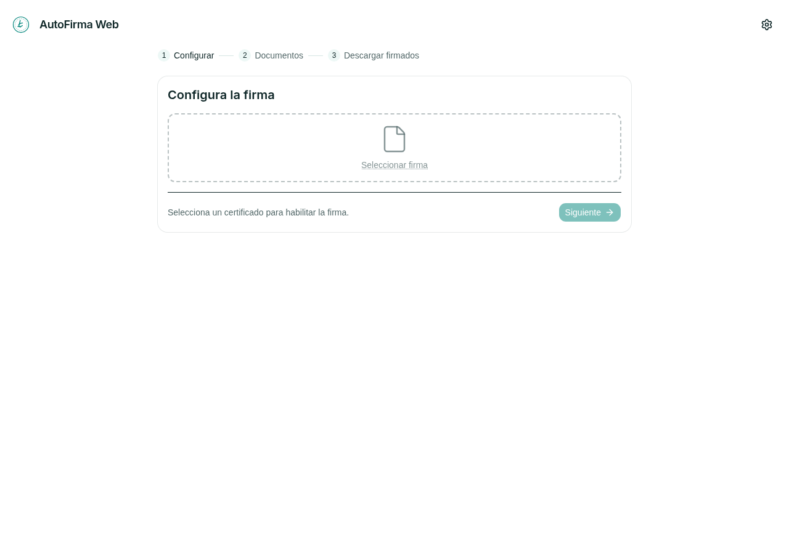

- **Selector por sitio**: cada origen debe habilitarse explícitamente; el resto sigue usando el
  AutoFirma nativo si está instalado.
- **Confirmación por operación**: se muestran el sitio, el formato, el archivo y el resumen antes de
  firmar.
- **Ajustes de extensión**: acceso por sitio, TSA y credenciales del puente MCP.

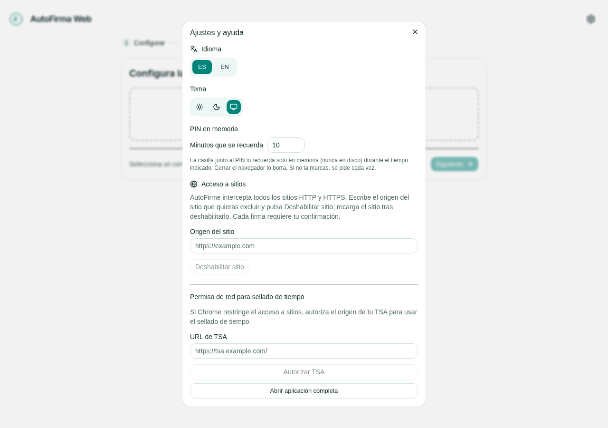

Requisitos: Chrome/Chromium 116+ y Node 22+ para compilar. Firefox está pendiente
([issue #18](https://github.com/Administracion-Abierta/AutoFirme/issues/18)).

```bash
pnpm install --frozen-lockfile
pnpm build:extension
# chrome://extensions → Modo desarrollador → Cargar descomprimida → dist/extension
pnpm package:extension   # ZIP + SHA256SUMS
```

Los detalles del contrato de sitio, la instalación y los límites están en
[`docs/CHROME-EXTENSION.md`](docs/CHROME-EXTENSION.md).

## Servidor MCP

`autofirma-mcp` expone el mismo motor de firma y verificación a agentes. Habla **stdio** para un
agente local y **Streamable HTTP** para uno remoto.

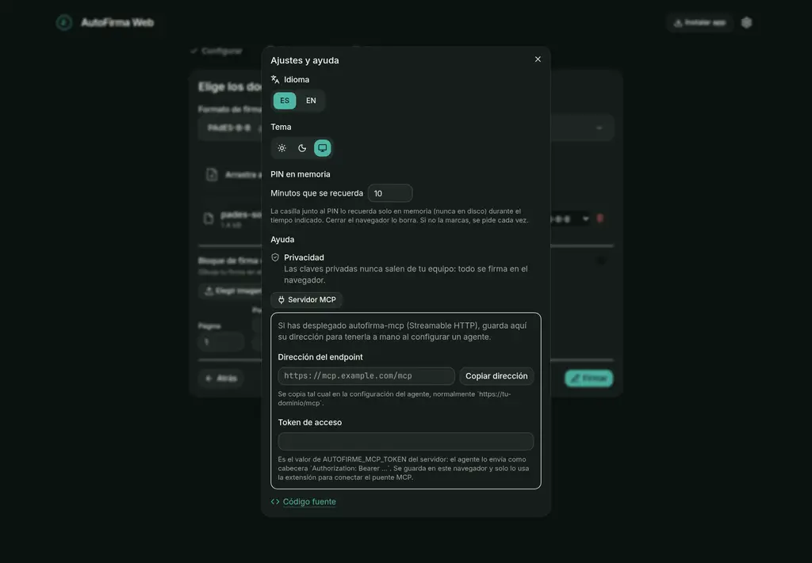

- Herramientas: `autofirma_list_certs`, `autofirma_sign` y `autofirma_verify` (CAdES).
- La clave se importa como `CryptoKey` no extraíble y no se escribe en disco.
- Los certificados salen de contenedores `.p12` precargados; el PIN se pasa por entorno.
- El transporte HTTP exige `AUTOFIRME_MCP_TOKEN`; el servidor se niega a arrancar sin él.
- La extensión puede actuar como puente: el servidor le pide la firma, la clave sigue en Chrome y
  cada trabajo requiere un clic humano.

```bash
cd mcp
pnpm install
pnpm build
pnpm test
pnpm e2e   # firma por stdio y verifica con openssl cms -verify
```

Configuración, transporte remoto y modelo de amenaza:
[`mcp/README.md`](mcp/README.md) y [`docs/MCP-DESIGN.md`](docs/MCP-DESIGN.md).

## Privacidad y seguridad

- **Sin telemetría, sin analítica y sin backend** para los flujos de firma del navegador.
- La clave privada nunca se serializa ni se envía; se usa como identificador opaco de WebCrypto.
- El PIN no se guarda en disco. Las identidades persistidas van cifradas con AES-GCM.
- Lo único que puede salir del equipo es el **resumen SHA-256** enviado a una TSA, y solo si se
  configura una.
- Las firmas se contrastan en las pruebas con `openssl cms -verify`, `openssl ts`, `pdfsig`, `qpdf`
  y `unzip -t`.

## Empezar en local

Requisitos: **Node 22+** (probado con Node 24), **pnpm 11.24.0** y un navegador moderno con
WebCrypto.

```bash
pnpm install
pnpm dev
```

Abre la URL que imprime Vite (por defecto `http://localhost:5173`). Para probar la instalación PWA
hace falta **HTTPS** o `localhost`.

## Autoalojamiento

El build es estático y no necesita Node en producción:

```bash
pnpm build          # genera build/
pnpm preview        # sirve el resultado localmente
```

Puedes servir `build/` con cualquier nginx, Caddy o alojamiento estático. El repositorio incluye un
`Caddyfile` con *fallback* para la SPA y un `Containerfile` multi-stage (Node → Caddy):

```bash
docker build -f Containerfile -t autofirme-web .
docker run --rm -p 8080:80 autofirme-web
```

Para producción, sirve siempre por **HTTPS**: lo exigen tanto el service worker como la instalación
como PWA.

## Desarrollo y pruebas

| Comando | Qué hace |
|---|---|
| `pnpm dev` | Servidor de desarrollo con recarga. |
| `pnpm build` | Build estático de la PWA en `build/`. |
| `pnpm preview` | Sirve el build estático. |
| `pnpm check` | `svelte-check` + TypeScript de la app y la extensión. |
| `pnpm test` | Vitest + pruebas de la extensión y de los artefactos. |
| `pnpm verify:real` | Firma real y verificación con OpenSSL. |
| `pnpm test:extension:browser` | Flujo completo de la extensión en Chromium. |
| `pnpm demo:registradores` | Prueba contra la web real de los registradores. |
| `pnpm build:extension` | Extensión desempaquetada en `dist/extension`. |
| `pnpm check:extension` | Comprueba el artefacto de la extensión. |
| `pnpm package:extension` | ZIP de la extensión y `SHA256SUMS`. |
| `pnpm check:versions` | Comprueba que la versión de la app y la del manifiesto coinciden. |

La criptografía no se valida solo contra sí misma: cada flujo tiene una comprobación con una
herramienta independiente. Los detalles y los resultados registrados están en
[`docs/CHROME-EXTENSION-VERIFICATION.md`](docs/CHROME-EXTENSION-VERIFICATION.md).

## Estructura del repositorio

```
src/lib/             núcleo de la app: firma, formatos, certificados, i18n, componentes
src/routes/          entrada SvelteKit
extension/           manifiesto MV3, background, content script y puente
mcp/                 servidor MCP (stdio + Streamable HTTP)
static/              iconos, manifiesto PWA y theme bootstrap
docs/                arquitectura, paridad, extensión, MCP y notas de ingeniería inversa
scripts/             builds, empaquetado, comprobaciones y pruebas de humo
test/                fixtures y scripts de verificación cruzada
demo/                prueba de la extensión contra webs reales
```

## Documentación

| Documento | Contenido |
|---|---|
| [`docs/architecture.md`](docs/architecture.md) | Mapa del núcleo de firma. |
| [`docs/PARITY.md`](docs/PARITY.md) | Paridad con AutoFirma 1.9 y huecos conocidos. |
| [`docs/USE-CASES.md`](docs/USE-CASES.md) | Casos de uso cubiertos. |
| [`docs/PIVOT-STUDY.md`](docs/PIVOT-STUDY.md) | Estudio de superficies y decisiones. |
| [`docs/CHROME-EXTENSION.md`](docs/CHROME-EXTENSION.md) | Extensión: instalación, protocolo y límites. |
| [`docs/MCP-DESIGN.md`](docs/MCP-DESIGN.md) | Servidor MCP: transporte, claves y amenazas. |
| [`docs/REVERSING-NOTES.md`](docs/REVERSING-NOTES.md) | Procedencia del estudio de AutoFirma 1.9. |
| [`docs/LEEME.md`](docs/LEEME.md) | Guía funcional en español. |

## Alcance actual y limitaciones

- **La interfaz web actual se centra en firmar**. El motor de verificación existe y se usa desde el
  servidor MCP; no hay una pestaña «Verificar» en esta versión de la app.
- **Sin acceso a DNIe, tarjetas criptográficas ni almacenes del sistema.** El navegador no ofrece
  esas APIs.
- **Sin OCSP/CRL** ni validación de sellos de tiempo recibidos.
- **XAdES-T y OOXML** tienen motor pero no selector en la interfaz.
- **Solo Chrome** para la extensión; Firefox está en estudio.
- La extensión es **no firmada**: Chrome exige Modo desarrollador para instalarla manualmente.

El proyecto es una implementación independiente, compatible con licencias GPL. La referencia
AutoFirma 1.9 se usa solo para comprender formatos y flujos.
