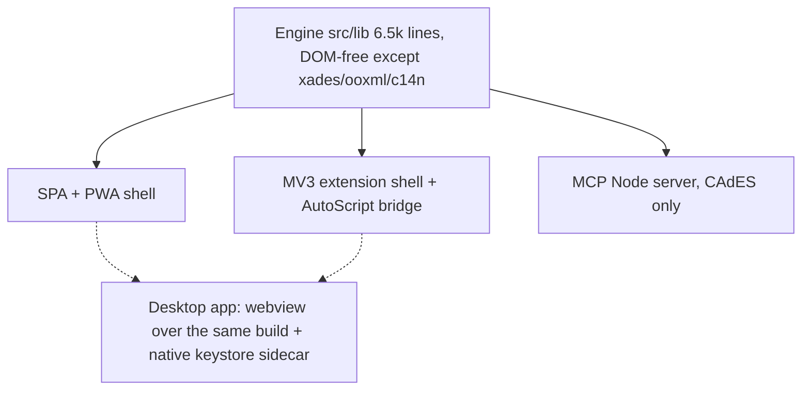

# Product-surface study: extension, desktop app, sign-only page

**Superseded 2026-10-20 by [`DESKTOP-ROADMAP.md`](DESKTOP-ROADMAP.md) §1**, which locks the

desktop app + extension as the two products and retires the hosted web app. Kept as history.

**Status:** decisions recorded 2026-10-16 — the desktop app is **discarded for now**, the web app
stays the primary surface and users who want a standalone app **install the PWA**, and DNIe /
smartcard support moved to
[README → Possible improvements](../README.md#possible-improvements). The analysis below stays as
the reasoning behind those calls. Every claim cites the repo. En español: el resumen de las
funciones está en [LEEME.md](LEEME.md).

---

## 0. The finding that reframes the question

The "pivot" is not three new products. Two of the three already ship, and a fourth (a Node daemon)
exists too. Today's tree is **one engine, four shells**:

| Shell | Size | Ships? | Source of truth |
|---|---|---|---|
| SvelteKit SPA / PWA | `build/` 1.6 MB | yes — `pnpm build`, static, self-hostable | `AGENTS.md` layout, `static/manifest.webmanifest` |
| Chrome MV3 extension | `dist/extension/` 1.4 MB, 911 lines of extension-only runtime | yes — packaged zip, dev pre-releases | `extension/`, `docs/CHROME-EXTENSION.md` |
| MCP server (stdio + Streamable HTTP, Node 22) | 894 lines `mcp/src/` | yes — own `Containerfile`, `deploy/k3s.yaml` | `docs/MCP-DESIGN.md`, `mcp/README.md` |
| Desktop app | — | **no** | `docs/PARITY.md:209-210` calls it "a product decision, not a code port" |

Shared core: 6,489 lines of engine (`src/lib/*.ts`, `src/lib/verify/*.ts`, tests excluded) +
2,457 lines of UI (`src/lib/App.svelte`, `src/lib/components/`). No WASM anywhere — grep
`WebAssembly|.wasm` over `src/`, `extension/`, `mcp/src` returns zero hits, so `AGENTS.md:17`'s
"WASM where needed" was never needed. Only two runtime deps: `fflate`, `pdf-lib` (`package.json`).

So the real questions are: **which surface is primary**, and **is a desktop app worth its cost**.
Everything below answers those two.

---

## 1. Web extension (already shipped)

**What it solves that nothing else does:** it is the only surface that intercepts the government
websites where Spanish citizens actually sign. `extension/manifest.json:12-14` declares `http://*/*` and
`https://*/*` as install-time host permissions; `page.js` + `core/adapter.js` wrap `AutoScript` /
`MiniApplet` calls in the page's MAIN world; verified against the live DGSFP test page
(`docs/CHROME-EXTENSION-VERIFICATION.md:101-107`). This replaces the *entire* reason AutoFirma 1.9
needed a desktop install: the `afirma://` handler and the localhost:63117 socket bridge
(`docs/PARITY.md:132-133`, both marked browser-moot by design).

### Pros
- **Zero-install for the end user; the extension *is* the migration path.** No `.exe`, no admin
  rights, no JRE, no per-OS configurator (`docs/USE-CASES.md:53` — the thing we deliberately do
  not rebuild).
- **Keys stay on the client.** Same guarantee as the SPA, plus the origin-bound chooser:
  request ownership bound to tab id + exact URL + `documentId`, explicit confirmation, no replay
  once signing starts (`docs/CHROME-EXTENSION-DESIGN.md:118-121`, `extension/background.js:67,206`).
- **Ship pipeline already green:** build, artifact checks, 43 unit tests, 18 artifact assertions,
  a real-Chromium end-to-end that cross-verifies CAdES with `openssl cms -verify`
  (`scripts/test-extension-browser.mjs`).
- **Auto-updates** via the browser's extension mechanism — answers `docs/PARITY.md:140`
  (1.9's auto-updater) for free.
- **Distribution is one zip.** No code-signing certificates, no notarization.

### Cons
- **Chrome-only until issue #18 lands.** Firefox is the browser where AutoFirma historically
  lived (NSS store, `/etc/firefox/pref/Autofirma.js`, `docs/REVERSING-NOTES.md:63`); the MAIN-world
  bridge needs the FF 128 `userScripts` API + a user-managed about:addons toggle
  (`extension/README.md:8-11`).
- **Publish is blocked on licensing, not code.** Upstream revision `d6dfa43` declared no
  application license (`extension/README.md:27-28`); today it loads unpacked in developer mode
  only. Self-hosting the zip is fine; the Web Store is not.
- **Deliberately narrow website contract:** `selectCertificate` + RSA/SHA-256 CAdES
  implicit/explicit, PAdES, enveloped XAdES and `AUTO` content sniffing, ≤ 4 MiB base64, no cert
  filters, no sticky identities, no custom stores — anything else, including detached XAdES,
  falls through to whatever the site already had (`docs/CHROME-EXTENSION.md:83-101`).
- **Cannot touch OS keystores or smartcards.** No Windows-MY, no Keychain, no NSS, no PKCS#11/PC/SC
  (`docs/PARITY.md:107-112`, all browser-moot). This is the gap the desktop app would fill.
- **Identity silo.** Extension-origin IndexedDB ≠ webapp-origin IndexedDB; imported containers do
  not migrate (`docs/CHROME-EXTENSION.md:45-46`). Two keystores already exist today.
- **No `chrome://` interception, and Chrome may withhold the wildcard**, degrading to per-origin
  grants (`docs/CHROME-EXTENSION.md:57-59`).
- **Highest maintenance surface:** MV3 service-worker lifecycle, dynamic script registration,
  permission events, browser-test scaffolding with a disposable profile and CDP.

---

## 2. Desktop app (does not exist)

There is no Electron/Tauri/anything-desktop reference anywhere in the repo (grep
`Electron|Tauri` = zero). The only prior consideration is `docs/MCP-DESIGN.md:48-54`, which rejects
a headless-browser harness for signing ("drags a browser runtime and its GPU/font sandbox into a
signing daemon … breaks on every UI refactor") and rejects re-porting to Java.

### Pros
- **It is the only way to close the DNIe / smartcard gap** — the one *real user* loss in the whole
  browser strategy. `docs/PARITY.md:110`: DNIe/CERES/CardOS/SmartCafe via vendor PKCS#11 is
  "missing / browser-moot"; `docs/PARITY.md:161-162` says the replacement (local bridge app or
  eID flow) "is a product decision that currently has no issue". For Spanish citizens whose
  certificate lives on the card issued with their DNI, a browser app simply cannot sign.
- **Reuses the engine almost for free.** The module-by-module platform audit
  (`docs/MCP-DESIGN.md:20-31`) shows everything Node-clean already: `cms.ts`, `pades.ts`,
  `pkcs12.ts`, `keystore.ts`, `zip.ts`, `verify/*` run on Node 22 with zero changes; only
  `xades.ts`, `ooxml.ts`, `verify/xades.ts` need a DOM (`DOMParser`/`XMLSerializer`), and
  `batch.ts` needs the Svelte store. A desktop app is a webview around the existing static `build/`
  plus a small native sidecar — not a rewrite.
- **OS keystore access becomes possible** (Windows-MY, Keychain, NSS), which `docs/architecture.md:283`
  already names as the reason a helper app would exist.
- **Offline / airgap by construction** — no browser, no secure-context dependency.
- **Native file dialogs and directory-level batch** replace the `load`/`save` protocol verbs
  (`docs/USE-CASES.md:175`) that a Blob-download UI does poorly.
- **Fits the institutional deployment story:** per-OS installer like the one citizens already
  expect, no "enable developer mode to load unpacked" step.

### Cons
- **The licensing problem gets worse, not easier.** Shipping a signed binary derived from a
  reverse-engineering study of an unlicensed upstream revision is a materially different legal
  position from serving a clean-room web app. Current status: "do not publish until its license is
  resolved" (`extension/README.md:27-28`).
- **Per-OS distribution is a new operational burden nobody in this repo has yet:** Windows Authenticode,
  macOS notarization + hardened runtime, `.deb`/`.rpm` packaging, ARM/x86 matrices, plus the secrets
  to do it. Contrast with `AGENTS.md`: "static build deployable on any nginx/k3s/static host,
  zero backend required for core flows".
- **Updates become our problem.** `docs/PARITY.md:140` marks 1.9's auto-updater
  missing/browser-moot *because* the browser updates for you. A desktop app rebuilds that exact
  complexity: signed update feeds, version skew, and a long-lived process holding live signing keys
  (`docs/MCP-DESIGN.md` threat model, "Server compromise" row — the accepted residual risk).
- **Third identity silo.** Desktop keystore joins webapp IndexedDB + extension IndexedDB. Three
  stores means three sets of trust decisions, three migration stories, and users who cannot find
  their own certificate. Anything shipped must first answer "which store is authoritative",
  with an import/export format that does not leak key material.
- **Overlaps the extension's unique value.** The website-interception reason to install something
  is already served, with fewer steps, by the extension. The desktop app's residual justification is
  *only* keystores/smartcards and portal-protocol compatibility — narrow, and specific to card users.
- **`afirma://` compatibility is a trap.** Reimplementing the legacy hand-off means re-adding the
  DES/gzip/base64 payload crypto and the secure-domain allow-list (`docs/USE-CASES.md:179-180`)
  and the localhost TLS certificate with root injection (`docs/PARITY.md:139`) — rebuilding
  precisely the attack surface the browser rewrite exists to delete.
- **Test infrastructure gap:** the browser E2E already only runs Chromium on Linux and cannot test
  real install prompts (`docs/CHROME-EXTENSION-VERIFICATION.md:111-118`); a desktop build multiplies
  the untested surface, not divides it.

**Cheapest credible desktop shape** if it happens: not Electron. A Node 22 sidecar (the existing
`mcp/` engine, extended to XAdES/PAdES) exposing PKCS#11/PC/SC + OS store, driving either
`dnie-remote`-style flows or a local webview of the already-built SPA. That keeps one engine and
adds only native keystore code. The precedent for the "no key export" boundary is already written
down: `docs/architecture.md:285` — "offer a native helper (out-of-band, no key export)".

---

## 3. Web page — "just sign"

### Pros
- **Already 90% there:** `?tab=firmar` / `?tab=verificar` deep links exist and mirror state into the
  URL (`src/lib/App.svelte:73-90`). A sign-only deployment is a URL, and can be pinned by an
  administration portal link with no UI decisions made for the user.
- **Smallest attack/explanation surface** for a first-time citizen; best mobile ergonomics; fastest
  to review and to translate.
- **Embeddable.** `docs/USE-CASES.md:51` and `:178` mark the *equivalent embed API* as the P0 gap:
  a portal-side "sign this document and hand it back" surface. A deliberately minimal sign page is
  the natural place to close that gap, and it is the replacement for `afirma://websocket`/`service`.
- **No new artifact:** same build, same version, same release pipeline.

### Cons
- **It is not smaller today.** Both tabs live in one 852-line `App.svelte` with shared `$state`
  (`src/lib/App.svelte:81`), and the bundle is dominated by `pdf-lib` + `fflate` + the engine, not by
  the verify UI. A real sign-only page is a component split plus a second route target — a refactor,
  not a build flag. Measured: `build/` 1.6 MB total, 980 KB of it JS.
- **Verification is a real second persona.** `PRODUCT.md §Users` lists people checking received
  `.csig`/`.xsig`/signed PDFs; deleting verify deletes that user. Sign-only as *the product*
  is a downgrade; sign-only as *a mode* is free.
- **Secure-context dependency stays.** `crypto.subtle` is withheld on insecure origins
  (`src/lib/App.svelte:70-72`, `i18n.ts:50`) — a hosted "just sign" page must be HTTPS everywhere,
  so it inherits hosting/trust questions rather than escaping them.
- **Version story pressure.** `AGENTS.md` keeps a single product version in `package.json` **and**
  `extension/manifest.json`, enforced by `pnpm check:versions`. A third independently-deployed page
  invites drift and a third thing to keep in step.

---

## 4. Cross-surface costs the pivot creates

1. **Keystore fragmentation** (biggest): 1 → 3 identity stores. Needs one answer before any new
   shell ships.
2. **Release matrix:** 2 workflows today (`release.yml`, `release-develop.yml`) + 1 container +
   MCP container. Desktop adds per-OS artifacts, signing secrets, and CI VMs.
3. **Verification load:** 304 automated tests now (235 vitest + 43 extension unit + 18 artifact +
   8 workflow), and the honest gaps are already documented as manual-only — real install prompts,
   real desktop AutoFirma fallback, Windows/macOS, live TSA, worker eviction
   (`docs/CHROME-EXTENSION-VERIFICATION.md:111-118`). More surfaces = more of that list.
4. **License gate** blocks binary/store distribution before a line of code is written.
5. **Terminology drift:** "AutoFirme", "AutoFirma Web", `autofirme-extension-*`, `autofirma_*` MCP
   tool names already coexist; three marketed products would make it worse.

---

## 5. Decision (recorded 2026-10-16)

- **One engine, three build targets — not three products.** The SPA is the product; the extension
  and the MCP server are targets of the same `src/lib` engine. Nothing forks the engine.
- **Primary surface: the web app, installed as a PWA when the user wants a standalone app.** No
  desktop build. `pnpm build` already emits `manifest.webmanifest` + `service-worker.js`
  (README "Installable app (PWA)" — #47), the header shows **Install app** when the browser fires
  `beforeinstallprompt`, and signing works offline once the shell is cached — "install it" needs
  no new artifact, only the prompt the user already gets. Two limits to keep honest: install
  requires HTTPS (same README section), and a PWA cannot intercept website calls, so the
  extension stays the only surface that answers a portal's `AutoScript` request.
- **Desktop app: discarded for now.** Its only unique value was native keystore access; the
  licensing and per-OS packaging costs (§2 Cons) outweigh it while the browser surfaces cover the
  flow. Revisit only if the DNIe/smartcard improvement is taken up — and then as a scoped
  PKCS#11/PC-SC helper extending `mcp/` (`docs/architecture.md:285`: out-of-band, no key export),
  never as an Electron repackage or an `afirma://` reimplementation.
- **Sign-only stays a mode, not a product:** `?tab=firmar` (`src/lib/App.svelte:73-90`) plus the
  P0 embed API gap (`docs/USE-CASES.md:51`), which is the true replacement for `afirma://`.
- **DNIe / smartcard support moves to possible improvements**
  (README → "Possible improvements"), replacing the "no issue" note on gap 4 of
  `docs/PARITY.md:161-162`.
- **Extension remains the integration surface**, with Firefox (#18) still deciding whether "works
  in the browser" is honest.
- **Still blocked before any store/binary publication:** resolve the application license at
  upstream (`extension/README.md:27-28`). Self-hosting the webapp and loading the extension zip
  are unaffected.
